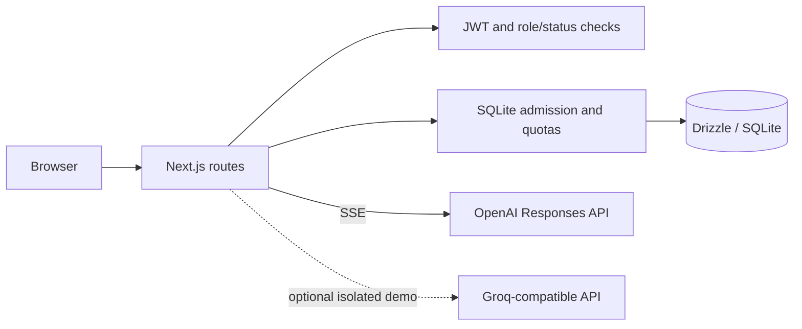

# Aegis AI

A self-hostable reference app for multi-user AI chat, access controls, and request governance. It demonstrates practical patterns; it is not security-certified or production-hardened.

## What it includes

- Next.js App Router, React, and TypeScript.
- Argon2id passwords, HttpOnly JWT sessions, `admin`/`member` roles, account status checks, and server-side authorization.
- OpenAI Responses API chat streamed over SSE; messages and conversations persist in SQLite through Drizzle.
- Admin provisioning, policy controls, transactional audit records, and bounded request quotas.
- Docker Compose with a persistent SQLite volume.
- A synthetic `/demo` playground. Optional live demo inference and a separate shared-account demo are disabled unless explicitly configured.

The landing illustration is original inline SVG. No hosted Aegis instance or shared credentials are claimed here.

## Try it locally

Use Node.js 24 and npm. OpenAI credentials are needed only for real private chat; scripted demo scenarios and tests require none.

```bash
git clone https://github.com/ansh0eman/aegis-ai.git
cd aegis-ai
npm ci
cp .env.example .env.local
```

Set a random `AUTH_SECRET` (at least 32 bytes) in `.env.local`; optionally set the server-side `OPENAI_API_KEY`. Never use a `NEXT_PUBLIC_` key or commit `.env.local`.

```bash
npm run db:migrate
npm run dev
```

Open `http://localhost:3000`. Development registration is open by default. To promote a local account to admin, use `npm run db:promote-admin -- user@example.com --local`.

## Explore

- `/demo` — synthetic personas, scripted chat, and local-only governance examples.
- `/login`, `/chat` — real account and private chat flows.
- `/admin`, `/admin/audit` — protected user, policy, and audit tools.

The scripted demo does not call a model. Optional live demo inference has a separate route/key and is disabled by default. See [demo boundaries](docs/demo.md) and [operator notes](docs/public-demo.md).

## Architecture



Private chat validates identity, ownership, policy, and quota before provider access. The server streams deltas and persists one complete assistant message only after successful generation. Optional public inference is separate and operator-gated.

## Local checks

```bash
npm run lint
npx tsc --noEmit
npm run test:sse
npm run test:step11
npm run test:demo
npm run build -- --webpack
```

Tests use synthetic data and do not call OpenAI or Groq. CI runs these checks on Node.js 24 for pull requests and pushes to `main`.

## Data and deployment

SQLite is intended for one app instance with persistent storage, not multi-replica hosting. Compose closes public registration and stores data in a named volume; a volume is not a backup. Read [self-hosting](docs/self-hosting.md) and the [future Ubuntu runbook](docs/deployment-ubuntu.md) before exposure. Hosting, DNS, TLS, and a public URL have not been verified or changed.

## Documentation

- [Architecture](docs/architecture.md) · [Authentication/RBAC](docs/authentication-and-rbac.md) · [Streaming](docs/streaming.md)
- [Database/concurrency](docs/database-and-concurrency.md) · [AI governance](docs/ai-governance.md) · [Demo behavior](docs/demo.md)
- [Engineering case study](docs/case-study.md) · [Recruiter guide](docs/recruiter-guide.md)
- [Contributing](CONTRIBUTING.md) · [Security reporting](SECURITY.md)

## Limits

There is no SSO/MFA, tenancy, SIEM integration, billing enforcement, or formal security certification. Application quotas do not guarantee provider spend. Admins cannot read other users' conversations. Optional shared accounts deliberately share their data. Review `docs/` for details.

## License

MIT. Third-party dependencies retain their own licenses; see package metadata and notices from the installed packages.
