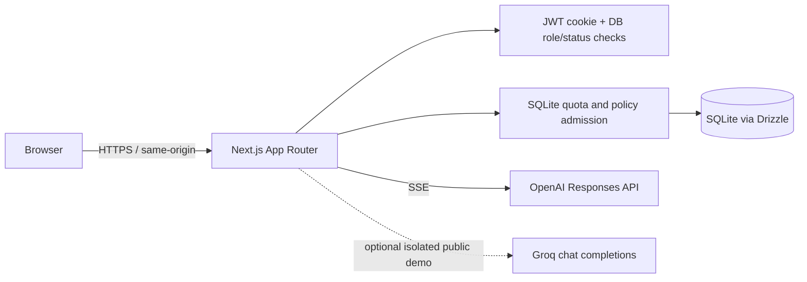

# Aegis AI

**A self-hostable reference workspace for multi-user AI chat, access governance, and operational safeguards.**

Aegis explores a problem that a basic chatbot does not address: how to give multiple people access to model-backed conversations while keeping account ownership, administrative changes, and request limits explicit. It is a portfolio/reference application, not a claim of certified or production-hardened security.

The public `/demo` page offers scripted, synthetic examples. A separately configured public shared-account demo and an optional Groq inference path also exist in source, but neither is automatically enabled or deployed by this repository. The private workspace uses OpenAI only when a server-side key is configured.

## What is implemented

- Email/password accounts with Argon2id password hashes and seven-day JWT sessions in HttpOnly cookies.
- `admin` and `member` roles, active/disabled states, server-side authorization, same-origin mutation checks, and owner-scoped conversation access.
- OpenAI Responses API streaming as Server-Sent Events (SSE), including stop/cancellation, safe failure events, and persistence of a completed assistant response.
- SQLite persistence through Drizzle ORM for users, conversations, messages, AI policies, usage, audit events, and demo request counters.
- Admin provisioning and account/policy changes, written with related audit rows in SQLite transactions.
- Per-user prompt/request policy checks performed transactionally before private inference admission.
- A synthetic browser-only playground at `/demo`; scripted mode does not call a provider or touch real user data.
- Optional public demo account and Groq inference workflows behind independent configuration gates, bounded quotas, timeouts, and prompt/output limits. Provider account tier cannot be proven by the app; operators must verify it.
- Docker multi-stage build, standalone Next.js output, non-root runtime, startup migration runner, and named SQLite volume.

Implementation details and limitations are documented in [`docs/`](docs/architecture.md).

## Explore

The landing page uses a small original inline SVG illustration of the browser → policy → model flow. It is part of `app/page.tsx`, not a screenshot or a third-party image.

- `/demo` — synthetic personas, scripted response playback, local governance controls, and synthetic audit history.
- `/login` — real login form; demo-account disclosure depends on deployment configuration.
- `/chat` — authenticated OpenAI-backed chat, when configured.
- `/admin` and `/admin/audit` — admin-only account, policy, and audit workflows.

No hosted application URL or shared credentials are published here. The application has not been deployed as part of this release-preparation phase.

## Architecture



In the private chat route, a request is authenticated and admitted against status, ownership, policy, and quota in SQLite before it is sent to OpenAI. The route streams typed SSE events to the browser and stores one complete assistant row after a successful provider completion. Public demo inference uses a different route, key, limits, and configuration; it is disabled unless an operator explicitly enables and verifies it. See [architecture](docs/architecture.md), [streaming](docs/streaming.md), and [demo boundaries](docs/demo.md).

## Technology

| Area | Implementation |
| --- | --- |
| Web application | Next.js 16 App Router, React 19, TypeScript |
| Private inference | OpenAI JavaScript SDK, Responses API, SSE |
| Optional demo inference | Server-side Groq-compatible streaming request; disabled by default |
| Authentication | Argon2id, `jose` JWT, HttpOnly cookie |
| Database | SQLite, `better-sqlite3`, Drizzle ORM and migrations |
| Container | Node 24 Debian slim, standalone Next.js output, Docker Compose |

## Local development

Prerequisites: Node.js 24, npm, and an OpenAI API key only if you intend to use real private chat. Scripted `/demo` scenarios and the automated tests do not require inference credentials.

```bash
git clone https://github.com/ansh0eman/aegis-ai.git
cd aegis-ai
npm ci
cp .env.example .env.local
```

Edit `.env.local` locally. Set a random `AUTH_SECRET` of at least 32 bytes. `OPENAI_API_KEY` is optional for development but required for private chat. Keep provider credentials server-side; never use a `NEXT_PUBLIC_` prefix. Do not paste secrets into issues or commit `.env.local`.

```bash
npm run db:migrate
npm run dev
```

Open `http://localhost:3000`. Registration is open in development by default. New users are members. For local admin testing, register a user, then use `npm run db:promote-admin -- user@example.com --local`; the script refuses production mode. Avoid using sensitive data in a shared/demo environment.

## Docker Compose

Compose runs one app instance, binds to loopback for local use, passes secrets at runtime, migrates before startup, and persists SQLite in the `aegis_data` volume. It closes public registration. The default local HTTP cookie setting is not suitable for public HTTPS hosting.

```bash
cp .env.example .env.local
# Set AUTH_SECRET and, if using private chat, OPENAI_API_KEY in .env.local.
docker compose --env-file .env.local config --quiet
docker compose --env-file .env.local up --build -d
docker compose --env-file .env.local logs --tail=100 aegis
```

Keep the volume when stopping: `docker compose --env-file .env.local down` (do not add `-v` unless you intend to remove local database data). Read [self-hosting](docs/self-hosting.md) and the [future Ubuntu deployment runbook](docs/deployment-ubuntu.md) before exposing anything publicly.

## Migrations and storage

The TypeScript schema is in `db/schema.ts`; generated SQL is in `drizzle/`. Local development applies migrations with `npm run db:migrate`; the container runs `scripts/migrate.mjs` before starting the standalone server. SQLite lives at `AEGIS_DATABASE_PATH` (defaults to `./aegis.db` locally and `/data/aegis.db` in Compose). The database and backups are excluded from Git and Docker build context.

The application is designed for one app instance with persistent local SQLite storage. Its in-process concurrency guards and SQLite deployment model are not a multi-replica architecture. See [database and concurrency](docs/database-and-concurrency.md).

## Authentication and authorization

Passwords are hashed with Argon2id. A signed HS256 JWT contains the user ID as subject and is stored in an HttpOnly, SameSite=Lax cookie. On each authenticated request, the server verifies the JWT, reloads role/status from SQLite, and rejects disabled or non-allow-listed public-demo accounts. Role checks and conversation ownership checks happen server-side. These controls do not replace TLS, host hardening, secret rotation, backups, or a security review. Details: [authentication and RBAC](docs/authentication-and-rbac.md).

## Governance and audit

`ai_policies` holds the enable switch, prompt-size cap, and daily request limit; `ai_usage` records admitted private chat requests. Admin user/policy updates and audit entries share SQLite transactions where coded. Audit records are append-only through the application API, but the SQLite file owner can still alter them. These request controls are not billing or spend guarantees; enforce provider-side limits too. Details: [AI governance](docs/ai-governance.md).

## Tests and checks

```bash
npm run test:sse
npm run test:step11
npm run test:demo
npm run lint
npx tsc --noEmit
npm run build -- --webpack
```

Tests use synthetic data and isolated temporary SQLite databases; they do not require or call OpenAI/Groq. See [CI](.github/workflows/ci.yml) and [testing notes](docs/database-and-concurrency.md#verification).

## Project map

```text
app/                 App Router pages and API route handlers
db/schema.ts         Drizzle table definitions
db/index.ts          Server-only SQLite/Drizzle connection
drizzle/             Generated SQL migrations and snapshots
lib/                 Server-side auth, authorization, quota, audit, and streams
scripts/             Migration and guarded operator tools
tests/               SSE, transaction/security, and public-demo tests
docs/                Architecture, operations, walkthrough, and case study
```

## Security assumptions and known limitations

- Do not expose the app publicly until HTTPS, `AUTH_COOKIE_SECURE=true`, secret management, backups, restore tests, registration policy, provider limits, firewall/SSH, and monitoring are deliberately configured.
- `AUTH_SECRET`, `OPENAI_API_KEY`, and optional `GROQ_API_KEY` are runtime server secrets. `.env.local`, SQLite files, backups, and container runtime configuration require operator protection.
- A public shared-account demo intentionally shares the demo users' saved messages and state among visitors. Never use personal or confidential information there. It must use its dedicated database path and volume; the code fails closed if these settings disagree.
- SQLite and in-process concurrency limiting are for a single app instance, not horizontal scaling. Local concurrency tests do not prove reliability under every deployment or filesystem.
- Admins manage users and policies but cannot read other users' conversations through the current app APIs.
- The app has no SSO, MFA, organizations/tenancy, SIEM integration, billing enforcement, PostgreSQL backend, or formal security certification.
- Optional demo Groq “free tier verified” is an operator assertion; code cannot determine a key's current billing plan. Keep the feature disabled if the provider account or pricing is uncertain.

See [known limitations and roadmap](docs/architecture.md#limits-and-open-work) and [security reporting](SECURITY.md).

## Contributing

Read [`CONTRIBUTING.md`](CONTRIBUTING.md) before opening a change. Keep behavior and security boundaries explicit, add focused tests, and never include secrets or private database content in patches.

## License

The project source is licensed under MIT. Third-party packages retain their own licenses when installed from npm; this license does not relicense those dependencies. The original landing illustration is authored as inline SVG, and system font stacks avoid bundling a separate font asset.

## Repository metadata recommendation

- Description: `A self-hostable multi-user AI workspace reference app with SSE chat, server-side RBAC, SQLite governance, and an isolated public demo.`
- Topics: `nextjs`, `typescript`, `sqlite`, `drizzle-orm`, `server-sent-events`, `rbac`, `ai-governance`, `docker`, `openai-api`
- Website: `https://ansh0eman.in` (portfolio; not an Aegis deployment URL)
