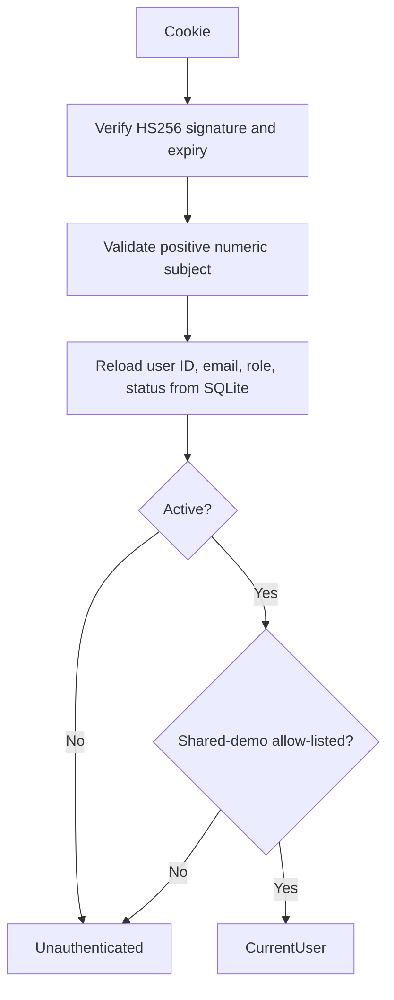

# Authentication and authorization

## Account lifecycle

`app/api/auth/register/route.ts` validates and normalizes email, requires a 12–128 character password, hashes it with Argon2id through `lib/password.ts`, and inserts a `member`/`active` account. Public registration is allowed outside production unless explicitly closed; in production it is closed unless `AEGIS_ALLOW_PUBLIC_REGISTRATION=true`. Public-demo mode always closes it.

Login (`app/api/auth/login/route.ts`) looks up the normalized email, verifies the Argon2id hash, and rejects disabled accounts with a generic invalid-credentials message. `lib/auth.ts` signs an HS256 JWT with a seven-day expiry using `AUTH_SECRET` (minimum 32 bytes), and stores it in an HttpOnly, SameSite=Lax cookie. Production defaults to `Secure`; public shared-demo sign-in explicitly requires `AUTH_COOKIE_SECURE=true`.

Logout (`app/api/auth/logout/route.ts`) deletes the cookie after a same-origin mutation check.

## Request-time identity

The JWT does not carry a role trusted by the app. `getCurrentUser()` reloads the account from SQLite on each request and rejects disabled accounts. The current role/status therefore takes effect without waiting for token expiry.

## RBAC and ownership

`lib/authorization.ts` exposes `requireUser()` and `requireAdmin()`. Pages such as `app/admin/page.tsx` and `app/admin/audit/page.tsx` check access server-side; APIs call the same helpers. Unauthenticated API requests receive 401 and authenticated non-admin users receive 403. Admin routes still scope shared-demo accounts to explicitly configured emails.

Conversations have a required `user_id` foreign key. `app/api/conversations/[id]/route.ts` checks both the conversation ID and current user ID before returning messages. The chat admission helper repeats the ownership check transactionally before a new message is saved. Admin status/policy controls do not confer conversation-reading access.

Browser-side links or hidden controls are not security boundaries; the server checks are authoritative. Cookie-authenticated write routes use `isSameOriginMutation()` from `lib/request-security.ts`.

## Threats and limitations

- A stolen session cookie remains usable until expiry or account status change; HttpOnly reduces script access but is not a complete XSS defense.
- SameSite and Origin/Fetch Metadata checks mitigate common cross-site mutation paths but do not replace TLS, safe rendering, or defense-in-depth.
- There is no MFA, email verification, password reset, SSO, or broad account recovery workflow.
- The app assumes `AUTH_SECRET` is random, private, stable across replicas, and rotated using an operator plan; no automatic rotation is implemented.
- Admin role assignment is an operator/local command (`scripts/promote-admin.mjs`), not a public endpoint.
- Shared demo credentials, when deliberately configured/published, are shared and disposable—not private identities.

Useful source: `lib/auth.ts`, `lib/password.ts`, `lib/authorization.ts`, `lib/request-security.ts`, `app/api/auth/`, `app/admin/`, and `app/api/conversations/[id]/route.ts`.
