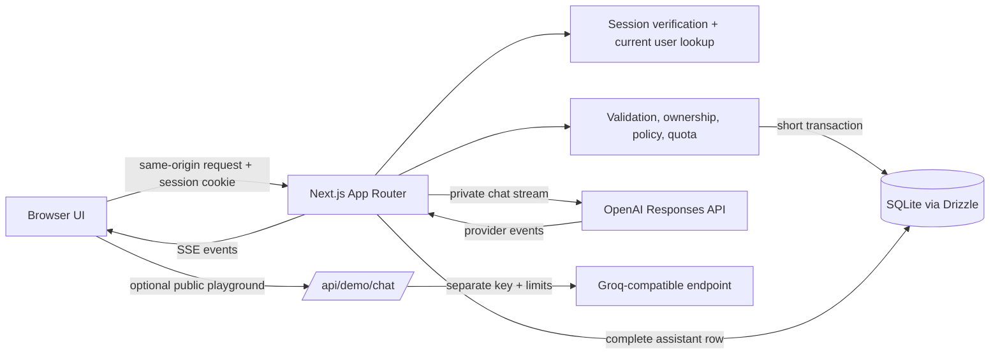

# Aegis AI: a governed multi-user AI workspace

Aegis AI is a portfolio project for studying how a browser-based AI workspace can connect identity, authorization, persistence, policy, and model inference. Its focus is not a novel model or a production service; it is the application boundary around model use: who can ask, what they can ask, how requests are admitted, how output is delivered, and what is recorded.

The project grew from a small Next.js chat example into a single-host reference implementation. Each step added one concept while keeping the browser-to-server path inspectable. This document describes the current source, its design choices, the failure cases it handles, and the limits that remain. It is not a security certification or a claim of production readiness.

## Project goals and constraints

The initial learning goal was to trace one request end to end: a browser submits a message, a Next.js route validates it, a model generates an answer, and the browser displays streamed text. The next goal was to preserve conversations and then give each conversation a real owner. Authentication and admin controls were added only after that basic path was understandable.

The current implementation explores:

- **Streaming inference:** server-side OpenAI Responses API streaming, SSE framing, incremental rendering, and cancellation.
- **Identity and access control:** Argon2id password verification, a signed HttpOnly JWT cookie, current user state loaded from SQLite, and server-side member/admin checks.
- **Relational persistence:** SQLite tables and generated Drizzle migrations for users, conversations, messages, policy, usage, audits, and bounded demo counters.
- **Governance:** prompt-size and daily-request limits, account enable/disable, per-user AI policy, and an optional isolated live playground with separate limits.
- **Mutation integrity:** transactions couple successful account changes with their audit records; chat admission serializes policy and quota checks with the corresponding writes.
- **Operational learning:** Docker standalone output, persistent local storage, migrations, and CI checks.

The constraints are intentional: one application instance, one SQLite database file per deployment, short recent-message context, no tenant model, and no external observability or identity provider. These choices keep the implementation small enough to study, but are not a recommendation for every workload.

## System map



The main boundaries are visible in the source tree:

| Area | Source | Responsibility |
| --- | --- | --- |
| Pages and client interactions | `app/` | Render server pages; client components handle form state and streamed events. |
| HTTP routes | `app/api/` | Check request origin, validate input, authorize, coordinate storage and providers, return responses. |
| Server-only logic | `lib/` | Authentication, authorization, admission, audit writes, provider stream parsing and demo limits. |
| Schema and database connection | `db/` | Drizzle table definitions and the server-side SQLite connection. |
| Schema history | `drizzle/` | Generated SQL migrations applied locally and at container startup. |
| Verification | `tests/`, `.github/workflows/ci.yml` | Offline tests and pull-request CI. |
| Runtime | `Dockerfile`, `compose.yaml` | Standalone Node container and persistent SQLite volume. |

## Private chat: from click to persisted answer

The browser sends JSON to `POST /api/chat` with the same-origin session cookie. The route first checks the origin and calls `getCurrentUser()`. The session helper verifies the JWT signature and expiry, then reloads the user's email, role, and status from SQLite. The token is not treated as the source of current role or account state; disabling an account therefore takes effect without waiting for the token to expire.

The route validates the request body, trims the message, and validates an optional positive integer conversation ID. It also checks the configured policy and prompt-size ceiling. `admitChatRequest` then uses a SQLite `BEGIN IMMEDIATE` transaction to recheck active status and policy, confirm that an existing conversation belongs to this user, load bounded history, check the UTC-day usage count, and atomically insert the current user message and a usage row. When no conversation ID is supplied, the same transaction creates an owned conversation first.

The history query fetches at most the latest **12 prior messages**, ordered by descending row ID for the limit and reversed back into insertion order. The new user message is inserted after that history is selected, and the helper returns only the prior messages. The route then appends the current message exactly once to the OpenAI Responses API input. The provider call happens after the database transaction commits, so a database lock is not held open while waiting on a network service.

The route translates provider text deltas into SSE `delta` events. `lib/chat-stream.ts` accumulates those deltas on the server. It writes one assistant row only after it observes `response.completed`; an error, incomplete result, provider exception, or client cancellation does not produce a completed assistant record. The browser can already have seen partial text when an interruption occurs, so a partial visible answer is not evidence that a complete assistant message was saved.

The core persistence rule is intentionally small:

```ts
if (event.type === "response.output_text.delta") {
  assistantText += event.delta;
  yield { event: "delta", data: { text: event.delta } };
} else if (event.type === "response.completed") {
  providerCompleted = true;
}
```

Only after stream iteration completes successfully does `streamChatEvents` call the persistence callback once with the complete text. This avoids a database row for every token/chunk and makes each assistant message a single queryable record.

### Context is not persistence

SQLite persistence means messages remain available to the application after a refresh. Model context means the messages explicitly included in a particular inference request. The provider does not automatically read the database. Aegis loads up to 12 earlier rows for the owned conversation and sends those role/content pairs along with the new user message. Twelve is a deliberately understandable bound, not a token-aware summarization algorithm; long messages can still consume a large share of a model context window.

The roles preserve turn semantics: `user` rows are user messages and `assistant` rows are assistant messages. The current user message is included once, after the stored history. System or developer instructions are not inferred from database rows. An empty/new conversation starts with just the current user message.

If model generation fails after admission, the new user message and usage count remain in the database. This records that an allowed request was attempted and allows the user to retry in the conversation. No assistant row is written for a failed or cancelled generation. The design does not currently provide a retry-state marker or deduplicate a retried user prompt.

## Identity, sessions, and authorization

Registration and login routes validate input and store Argon2id password hashes, never plaintext passwords. `lib/password.ts` configures Argon2id with memory cost 19,456 KiB, time cost 2, and parallelism 1. Successful login creates a seven-day HS256 JWT. The cookie is named `aegis_session`, is `HttpOnly`, uses `SameSite=Lax`, and is `Secure` in production unless explicitly configured otherwise. `AUTH_SECRET` must be at least 32 bytes.

The server-only `getCurrentUser()` verifies the JWT, reads the subject as a user ID, reloads the current account from SQLite, and rejects missing or disabled accounts. `requireUser()` and `requireAdmin()` compose this identity check with route/page access decisions. The API returns 401 for a missing/invalid session and 403 for an authenticated member requesting an admin-only operation. Cookie-authenticated mutations also check same-origin request metadata.

Role and status are deliberately reloaded from the database for every request instead of trusted as stale JWT claims. This adds a database lookup, but keeps an admin's role/status change effective immediately. These controls are application-level protections; they do not defend against a compromised server or a person with direct access to the database and signing secret.

## Relational model and migrations

`db/schema.ts` defines the relational records; `db/index.ts` constructs the server-only SQLite connection. Drizzle provides typed queries and migration generation, while SQLite is the database engine that stores and constrains the rows. Generated migrations under `drizzle/` are the reviewed history of schema changes. The container applies them before starting the standalone server.

| Table | Main relationships and purpose |
| --- | --- |
| `users` | Unique email, password hash, constrained `admin`/`member` role and `active`/`disabled` status. |
| `conversations` | Required owner FK to `users`; a chat belongs to one account. |
| `messages` | Required conversation FK, constrained `user`/`assistant` role, content and insertion timestamp. |
| `ai_policies` | One policy row per user, with bounded prompt and daily-request settings. |
| `ai_usage` | One row per admitted private AI request, used to count requests by UTC day. |
| `audit_logs` | Actor FK, optional target FK, constrained action, small safe metadata and timestamp. |
| `demo_request_buckets` | Composite-key counter buckets for bounded public demo admission; scopes contain fixed labels or keyed hashes, not raw prompt/email/IP values. |

Conversations and messages are separate rows rather than a JSON blob. That supports foreign-key ownership, ordered message retrieval, bounded history, and selective queries without loading or rewriting an entire transcript. Integer primary keys provide row identity; foreign keys express ownership relationships and deletion behavior. Checks and unique indexes constrain values and relationships that should not depend only on UI validation.

Schema changes follow the repository migration workflow: edit `db/schema.ts`, generate SQL with `npm run db:generate`, inspect the generated migration, and apply it with `npm run db:migrate` against a local database. The migration file is committed with the code. A production operator should back up the database before applying migrations and should test restore procedures; the migration command alone is not a backup strategy.

## Transactions, concurrency, and rollback

SQLite serializes writes. Aegis uses immediate transactions for operations where a read/check/write sequence must not be interleaved by another writer. Chat admission rechecks active status and policy, checks the conversation owner and request quota, then records the new user message and usage row in one transaction. Public demo limit admission similarly serializes checking and incrementing global and, when a trusted proxy is configured, per-IP buckets.

Admin provisioning and status/policy updates pair the business write with its audit event inside the same transaction. If audit insertion throws, the account mutation rolls back instead of leaving an unaudited success. Bulk provisioning hashes passwords before opening the write transaction, avoiding a long SQLite lock during Argon2 work; duplicate emails become per-item failures, while successfully inserted users and their audit records share the transaction.

There is no transaction across OpenAI/Groq network calls. Holding a SQLite write lock while waiting on an external API would unnecessarily block unrelated writes and cannot make the provider part of a local ACID transaction. Consequently, chat admission is durable before inference, and the assistant result is a separate write after successful provider completion.

The basic race being prevented is two simultaneous requests both observing one remaining quota slot:

```text
Request A: BEGIN IMMEDIATE → read count → admit + increment → COMMIT
Request B:                                  waits for A → read new count → reject
```

The independent-connection tests exercise this kind of admission, lock failures, audit rollback, concurrent provisioning, and status changes. SQLite busy/lock errors can still fail a request; there is no general retry queue or distributed lock service. This database model assumes a single app instance and local persistent storage.

## Policy, usage, and audit

An administrator can enable/disable an account and configure per-user AI availability, maximum prompt characters, and daily request count. The policy is checked in the server route and rechecked inside admission. These controls govern request admission; they are not token accounting, cost attribution, or a guarantee that provider-side spending stays under a monetary ceiling. Provider projects still need their own limits and monitoring.

`ai_usage` counts admitted private requests by user and UTC calendar day. Failed provider calls still count because admission succeeded and the user message was saved. No prompt or assistant content is copied into this usage table. It is not detailed latency, token, or model telemetry.

Audit records are written only by server code after successful mutations. Current action types include user provision/enable/disable and AI policy update. The admin API returns a bounded recent event list with safe actor/target identity fields, and the admin page renders it newest-first. Passwords, password hashes, JWTs, API keys, and prompts are not audit metadata. The application exposes no edit/delete audit endpoint, but database-file owners can still alter records; this is not tamper-proof logging or an external SIEM.

## Public playground and live inference boundaries

The `/demo` playground contains synthetic members, policy values, and audit entries in client-side state. Its scripted scenarios do not call OpenAI or read/write real user records. A separate optional `/api/demo/chat` route supports live, arbitrary demo prompts using a Groq-compatible chat-completions API, not the private OpenAI route. It is disabled unless explicitly configured, requires an operator confirmation that the provider account's free tier was checked, restricts model IDs to an allowlist, caps prompt/output/duration, limits concurrent inference, and uses database counters for global and (only behind an explicitly trusted Railway proxy) per-IP rate limits.

The live demo uses `GROQ_API_KEY`; private workspace inference uses `OPENAI_API_KEY`. Both are server-only environment variables. The demo route does not authenticate a visitor or persist conversation content, but it can spend provider quota when deliberately enabled. Public demo safety is layered and bounded, not proof of abuse resistance. Shared-account demo mode, when separately configured, is a distinct real authenticated deployment and intentionally shares that deployment's account data; it is not the synthetic `/demo` playground.

## Cancellation and safe failures

The private chat route returns `text/event-stream` and propagates browser cancellation to the OpenAI stream. A public demo timeout and concurrency slot are released in cleanup paths. Error messages are fixed, user-facing text; provider credentials and internal stacks are not returned. When a response is interrupted, the browser may retain partial text in the current UI, but the server will not persist it as a complete assistant message. SSE is one-way and not resumable: reconnecting does not continue the same provider generation.

The live demo also validates bounded JSON before inference, checks same-origin mutations, returns generic provider error categories, and cancels its upstream reader when the caller disconnects. Request limits use fixed windows and only trust forwarded client IP data when the deployment proxy is explicitly selected. Incorrect proxy configuration can make the per-IP check unavailable; the global limit remains the fallback.

## Container and CI

The multi-stage `Dockerfile` builds with Node 24 on Debian and uses the Next.js standalone output. The runtime runs as the unprivileged `node` user, copies the migration runner and migration files, sets `AEGIS_DATABASE_PATH=/data/aegis.db`, applies migrations before the server starts, and expects `/data` to be a persistent mounted volume. Losing that volume loses local accounts and conversations; a volume is not itself a backup.

GitHub Actions installs the lockfile dependencies and runs lint, TypeScript, the SSE suite, transaction/security tests, demo tests, and the webpack production build for pull requests and pushes to `main`. The automated suites do not call OpenAI or Groq. They validate selected software behavior but do not establish production network behavior, billing controls, restore reliability, a host's TLS setup, or multi-replica correctness.

## Verification snapshot

The repository's repeatable local checks are:

```sh
npm ci
npm run lint
npx tsc --noEmit
npm run test:sse
npm run test:step11
npm run test:demo
npm run build -- --webpack
```

The exact test counts are determined by the checked-in test files and should be reported from the run, not treated as a permanent promise in this document. A successful local build demonstrates that the source compiles in that environment; it does not verify a future deployment. No paid provider call is needed for these checks.

## Trade-offs and limitations

- **SQLite simplicity vs. scale:** one local file makes development and a single-host deployment straightforward. Multiple replicas need shared transactional storage and distributed admission limits.
- **Fixed message count vs. token-aware context:** 12 prior messages bound retrieval simply, but message sizes vary and no summarization strategy exists.
- **Request quotas vs. cost governance:** daily request counts and output caps are coarse guards, not actual token or currency metering.
- **Short-lived JWT vs. database lookup:** every request checks current user state, adding a query in exchange for prompt role/status revocation.
- **Local audit vs. tamper evidence:** transactions keep audit writes consistent with mutations, but a host/database owner can still edit the file.
- **SSE vs. resumability:** users see output early and cancellation is propagated, but interrupted streams cannot resume and partial text is not saved.
- **Optional public live inference:** independent provider configuration and conservative limits reduce accidental exposure but cannot guarantee free usage or prevent all abuse.

The project does not implement SSO/MFA, organizations or tenant isolation, external SIEM delivery, billing enforcement, a distributed job/lock system, multi-region availability, token/cost/latency telemetry, prompt redaction, or a verified public Aegis deployment. These are future design questions, not implied capabilities.

## What I learned

1. Durable conversation history and model memory are separate: the application decides exactly which prior rows to send on each request.
2. Database transactions should protect short, local invariants, not wrap slow provider calls.
3. Streaming means partial output is observable before it is durable; completion signals must be explicit before persistence.
4. Identity claims that change over time (role and account status) should be checked against current server state.
5. A UI that says “disabled” is not an authorization check; routes and data queries must enforce the same boundary.
6. A useful demo should label synthetic state honestly and isolate public provider inference from authenticated user data.
7. Tests around concurrent connections and injected failures make transactional claims concrete, but they still cover only the modeled failure cases.

For implementation detail, see [architecture](architecture.md), [authentication and RBAC](authentication-and-rbac.md), [database and concurrency](database-and-concurrency.md), [public demo](public-demo.md), and [self-hosting](self-hosting.md). This project is a learning/reference implementation; review the threat model and deployment controls before adapting it to real users.
