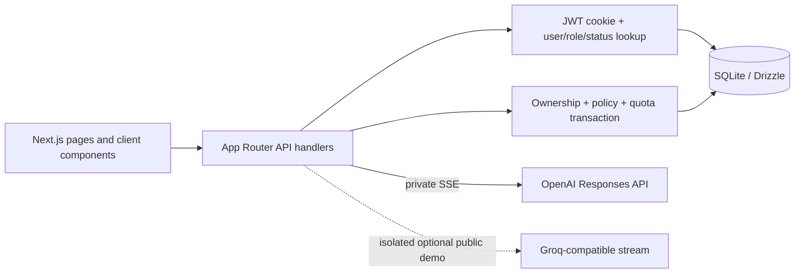
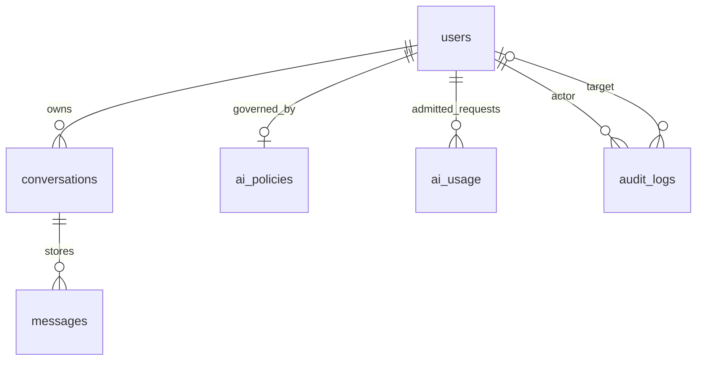

# Engineering Aegis AI: Building a Governed, Multi-User AI Workspace

## Project scope

Aegis AI is a portfolio reference application built to explore a question beyond “can a browser send a prompt to a model?”: how should a small multi-user workspace make identity, access, usage limits, persistence, and administrative actions explicit around AI inference?

The implementation is a learning project, not a certified enterprise product. The sections below describe the current repository; optional or future deployment choices are called out rather than presented as live infrastructure.

## A. Motivation and requirements

A one-user chatbot can often keep its state in a browser and call a model endpoint. That leaves important multi-user questions unanswered: who made the request, which conversation is theirs, what happens when an account is disabled, how do admins change policy, what usage is admitted, and how can an operator explain a status change?

I used the project to connect those concerns through one understandable path: browser → Next.js route → authorization and SQLite admission → provider stream → browser, with successful completed output persisted back to SQLite.

### Functional requirements represented in code

- Register/sign in/out with hashed passwords and an expiring session.
- Separate admin/member permissions; active/disabled account states.
- Keep conversations owned by a user and reload them after refresh.
- Stream responses and support stop/cancel behavior.
- Apply per-user AI enablement, prompt-length, and daily request limits.
- Let admins provision accounts, change status/policy, and inspect a recent audit trail.
- Keep a public synthetic playground distinct from real authenticated data.

### Nonfunctional concerns

I wanted the boundaries to be inspectable in a small TypeScript codebase: server-only secrets, explicit input validation, relational constraints, transaction-focused writes, safe provider errors, and tests that do not depend on paid model calls. The implementation does not claim complete defenses against a hostile host, distributed abuse, every deployment failure, or all web threats.

## B. Architecture

The UI lives in `app/`. Protected page components perform server-side checks before rendering; client components own form state and read SSE. Route handlers in `app/api/` validate HTTP data and call server helpers in `lib/`. `db/index.ts` creates a server-only `better-sqlite3`/Drizzle connection from `AEGIS_DATABASE_PATH`.

### Private request lifecycle

1. The browser posts `{ message, conversationId? }` to `/api/chat` with the session cookie.
2. The route checks same-origin context, finds the active user from the signed cookie, parses/validates the body, and checks effective policy.
3. `admitChatRequest()` uses an immediate SQLite transaction to recheck user status, verify ownership, fetch the latest 12 earlier messages, check UTC-day request usage, create a conversation if needed, save the new user message, and record admitted usage.
4. After the transaction commits, the route calls the OpenAI Responses API with the earlier role/content messages plus the current user message once.
5. Provider text deltas are converted to application SSE `delta` events. The browser decodes UTF-8, parses SSE frames, and appends text to one assistant message.
6. Only after a completed provider event does the server insert one complete assistant row and emit `done` with the conversation ID.

If generation fails or is cancelled, the already committed user message and usage entry remain; incomplete assistant content is not persisted. This avoids holding a database write lock during a network call, but it means a failed turn is visible in message history and counted as admitted usage.

### Why Next.js and TypeScript

Next.js App Router puts server-rendered pages, client components, and same-origin Route Handlers in one repository. TypeScript expresses request/event shapes and database roles. The tradeoff is tighter coupling between UI and backend than a separately versioned API service. A separate service could scale/deploy independently, but would add a boundary and operations burden not needed for this reference app.

## C. Authentication and RBAC

`lib/password.ts` hashes passwords using Argon2id with explicit memory/time/parallelism settings. `lib/auth.ts` signs an HS256 JWT with a seven-day expiration and stores it in an HttpOnly, SameSite=Lax cookie. `AUTH_SECRET` must be at least 32 bytes. `getCurrentUser()` validates the token, reads its subject, then reloads user ID/email/role/status from SQLite on every request; the role is not trusted from a client-controlled field or JWT claim.

`lib/authorization.ts` provides `requireUser()` and `requireAdmin()`. Page-level checks protect `/admin`; API routes perform their own checks, so hiding a browser link is not the authorization mechanism. Conversation fetch and chat admission constrain queries by both conversation ID and current user ID. Admin privileges do not imply message-reading privileges.

New registrations receive `member` and `active`. Public registration is closed in production unless an explicit flag opens it; public shared-demo mode closes it regardless. Admin provisioning creates members. Status is reloaded on requests, so disabling an account makes its existing JWT unusable without waiting for expiration.

### Threats and limits

Argon2id slows offline password guessing if a hash database leaks; it cannot make a weak password safe. HttpOnly reduces token exposure to ordinary browser scripts but does not eliminate XSS, stolen-device, or host risks. SameSite and same-origin checks are useful CSRF controls but do not replace TLS and output safety. There is no MFA, SSO, email verification, password reset, account recovery, or token revocation list. `AUTH_SECRET` compromise invalidates the session trust boundary; rotation is an operator-managed action.

## D. Inference and streaming

### Private OpenAI integration

`app/api/chat/route.ts` reads `OPENAI_API_KEY` only on the server and uses the official `openai` SDK Responses API with `stream: true`. Current source selects `gpt-6-luna`; model access depends on account configuration and could change. The request receives at most 12 prior messages and the new user message, preserving `user` and `assistant` roles.

The route translates model events to named SSE events. `TextEncoder` encodes server event strings to response bytes. The browser's `ReadableStream` reader gets arbitrary byte chunks; `TextDecoder` converts them incrementally to UTF-8 text, and `SseParser` reconstructs event boundaries. Network chunk boundaries do not equal application message boundaries.

`AbortController` is wired through browser fetch cancellation to the provider stream. A completed event is required before the server writes one assistant message. Partial output can be displayed but is not treated as a completed, persisted answer. A response failure reports a safe generic message rather than a provider stack trace or key.

### Optional Groq path

The public Quick Demo has a separate `/api/demo/chat` route and provider helper. It sends one prompt with a synthetic-demo system message to a Groq-compatible chat-completions endpoint and parses upstream SSE. It uses `GROQ_API_KEY`, not `OPENAI_API_KEY`, and is disabled unless enablement, key, supported model, and an explicit free-tier operator confirmation are all present. The application cannot verify billing tier. It limits concurrent requests in process and bounds prompt, output, duration, and shared rate counters. Do not infer that a model ID prefix chooses a provider: this path's endpoint host is Groq.

## E. Data model

`db/schema.ts` defines users, owned conversations, role-tagged messages, per-user policy, per-request usage, audit records, and demo request buckets. SQLite constraints enforce unique email, allowed roles/statuses/message roles/actions, policy bounds, and foreign keys. `drizzle/` holds generated migration history; `scripts/migrate.mjs` applies existing migrations at container startup.

SQLite is an embedded relational file database. It fits this single-host, low-operations learning setup and makes local tests easy to isolate. Drizzle is the TypeScript ORM/query and migration layer, not the database. PostgreSQL would offer a stronger path to shared network database operations and multi-instance deployment; it adds a server/service and still requires migration/backup operations. The current schema and connection are SQLite-specific.

Relational tables keep owners, message ordering, policies, and audit actors/targets queryable and constrained. One JSON conversation blob would make per-message ordering, foreign keys, indexing, updates, and concurrent changes less explicit.

## F. Concurrency and transaction integrity

### ACID and immediate transactions

ACID is the common shorthand for atomicity, consistency, isolation, and durability. A SQLite transaction groups writes; if an error occurs before commit, they roll back. The repository uses Drizzle's SQLite transaction helper. For admission/changes that must serialize check-and-write logic, `{ behavior: "immediate" }` requests a write reservation early (SQLite `BEGIN IMMEDIATE` semantics) so two independent connections cannot both claim the same last quota slot.

### Quota race

Naïve flow “read usage, compare limit, then increment” is unsafe under concurrency: two requests can read the same remaining slot. `lib/chat-admission.ts` rechecks status, policy, ownership, and usage while holding one immediate transaction, then writes the user message and usage. `tests/step11-database.test.mjs` launches workers on separate SQLite connections and asserts only one of two contenders gets the final slot.

### Disable-account race

Authentication happens before chat admission; an admin could disable the user between those operations. The admission transaction re-reads active status under the same write reservation as quota/message admission. The associated test changes status after the earlier auth boundary and confirms that no message/usage rows are admitted.

### Provisioning and audit rollback

Passwords are hashed before entering the transaction so the CPU-expensive Argon2 work does not hold the SQLite write lock. `provisionUsersWithAudit()` inserts the newly created member and its audit event inside one transaction; a uniqueness conflict becomes a per-row failure. Status changes and audit rows share an immediate transaction. AI policy changes and `user.ai_policy_updated` also share a transaction. A test-only SQLite trigger injects audit failure and verifies the business write rolls back.

Transactions are kept out of provider network calls. This keeps write locks short, but intentionally does not make user-message admission and eventual assistant completion one atomic unit across the external API.

### What the tests establish

The worker tests use independent SQLite connections to verify selected concurrency and rollback cases. They are stronger than one-connection unit tests, but do not prove power-loss behavior on a future laptop, every filesystem's locking semantics, production traffic limits, or horizontal scaling. Busy errors fail closed; there is no general retry queue.

## G. Enterprise AI governance

Admins can provision up to 50 members per request, disable/re-enable accounts, and set AI enabled, maximum prompt characters, and maximum requests per UTC day. Limits have server-side bounds and database checks. `ai_usage` records accepted private request admissions. It is not token, latency, model, cost, or success telemetry. A failed provider call still consumes the admitted request and leaves the user message.

Successful provisioning, status transitions, and policy updates write server-side audit records with actor/target IDs and safe small metadata. Audit listing returns a recent newest-first sample (up to 100 rows). The public demo API/page scopes visible audit events to configured demo identities; synthetic playground audit entries are only local state.

These policies are governance controls at the application boundary, not provider billing controls. They do not enforce a dollar budget or guarantee an account cannot be charged. Operators need provider-level quota/alerts and must keep demo limits conservative. There is no cross-provider policy engine or cost attribution.

## H. Public demo

The public `/demo` page's Maya (admin), Alex and Jordan (members) are fictional personas. The role picker, status/policy changes, sample conversations, and audit events are a client-side simulation; refresh resets them. Scripted chat responses are preset and incrementally revealed without any inference request.

The optional live Quick Demo inference calls Groq from a separate server route and has no authenticated user records. It is not the same as the separately configurable Full Application Demo. That mode uses real JWT auth and DB tables in a dedicated `aegis-public-demo.db` deployment with three deliberately shared accounts. Any records saved to those accounts are visible to visitors using them. Setup/reset scripts are guarded to the intended database file. No public hosted URL or credentials are asserted in this case study.

Recruiters can inspect the synthetic role differences, scripted chat, and synthetic event flow without credentials. To evaluate real authorization, a separate local/private app with a provisioned account is needed; the synthetic controls do not prove server RBAC.

## I. Docker and future deployment

The Dockerfile builds dependencies, app, and runtime in separate Node 24 Debian slim stages. The final runtime uses Next standalone output, copies static/public files and migrations, runs as `node`, and sets `/data/aegis.db` as SQLite path. Compose mounts a named volume at `/data`; replacing a container should not replace that volume. Startup migrations apply pre-generated SQL before the server starts.

The volume is persistence, not backup. Restore tests, off-device encrypted backups, TLS, secure cookies, secret storage, host updates, monitoring, and recovery still require operator work. SQLite and an in-process concurrency gate assume one application instance. Multi-instance hosting should move to a deployment/data model designed for it.

The future plan is an Ubuntu Server host with Docker Compose and a Cloudflare Tunnel routing HTTPS at `aegis.ansh0eman.in` to a loopback-bound app. The server, domain/tunnel configuration, and public URL have not been verified here; no DNS or hosting changes are part of this repo task.

## J. Testing and verification

The repository includes:

- `tests/sse-parser.test.mjs`: framing/UTF-8 splits, successful completion, provider error, failed persistence, and cancellation.
- `tests/step11-database.test.mjs`: quota contention, lock failure, duplicate/concurrent provisioning, audit rollback, status changes, disabled account race, foreign keys/check constraints.
- `tests/step11-security.test.mjs`: production registration default and same-origin mutation checks.
- `tests/demo-playground.test.mjs`: synthetic personas, permissions, local policy/status changes, scripted scenarios and reset.
- `tests/demo-inference.test.mjs`: provider config/validation/stream parsing and limit behavior using stubs.
- `tests/public-demo.test.mjs`: demo isolation, config, login/admission limits and guarded setup/reset.

Automated tests are designed not to call paid model APIs. CI runs tests, lint, `npx tsc --noEmit`, and the webpack production build. A passing local suite is not production acceptance. The future host, Cloudflare/TLS, real provider billing state, public abuse resistance, restore process, and multi-user physical-browser acceptance need separate verification.

## K. Tradeoffs and lessons

| Choice | Why here | Cost / alternative |
| --- | --- | --- |
| SQLite | Simple file-backed local/self-hosted data, low setup overhead | One-host/single-instance posture; PostgreSQL is more suitable for distributed app replicas |
| Next.js Route Handlers | Keeps UI and server path in one TypeScript project | UI/API deployment are coupled; separate service provides stronger independent boundaries |
| SSE | Simple server-to-browser streaming for text | One-way, not resumable; WebSocket only if bidirectional interaction becomes necessary |
| Real private inference plus simulation | Demonstrates a real server stream while keeping public walkthrough safe | Provider use costs money; scripts are not representative of model quality |
| Explicit transactions and bounded quotas | Protect selected check/write invariants | Busy locks still fail; application quotas are not spend guarantees |
| Small, direct helpers | Keeps the learning path traceable | Not a generalized policy, provider, or tenant framework |

The recurring boundary is important: the database remembers records, but an external model only sees the input sent on each call; persistence is not automatic model memory. Likewise, a simulated admin screen can illustrate policy but cannot substitute for a server authorization check.

## L. Future improvements

Meaningful work still open includes deployment/runbook acceptance on the actual Ubuntu host, HTTPS and Cloudflare Tunnel verification without altering the portfolio site, backup/restore drills, operations monitoring, review of transitive dependency notices for bundled distributions, and an explicit retention/deletion policy. The unprovenanced hero JPEG was removed and replaced with original inline SVG; the source is MIT licensed. If scaling beyond one host becomes a real need, evaluate PostgreSQL and shared distributed rate limiting. MFA/SSO, multi-tenancy, token/cost telemetry, external SIEM, billing, and agents are not implemented and should be separate scoped projects.

## Source map

- Authentication: `lib/auth.ts`, `lib/password.ts`, `lib/authorization.ts`
- Private chat: `app/api/chat/route.ts`, `lib/chat-admission.ts`, `lib/chat-stream.ts`, `app/chat/chat-client.tsx`
- Schema/concurrency: `db/schema.ts`, `db/index.ts`, `lib/admin-user-transactions.ts`
- Governance/audit: `lib/ai-policy.ts`, `lib/audit-write.ts`, `lib/audit.ts`, `app/api/admin/`
- Demos: `app/demo/`, `app/api/demo/chat/route.ts`, `lib/demo-inference.ts`, `lib/demo-playground.ts`
- Runtime: `Dockerfile`, `compose.yaml`, `scripts/migrate.mjs`
