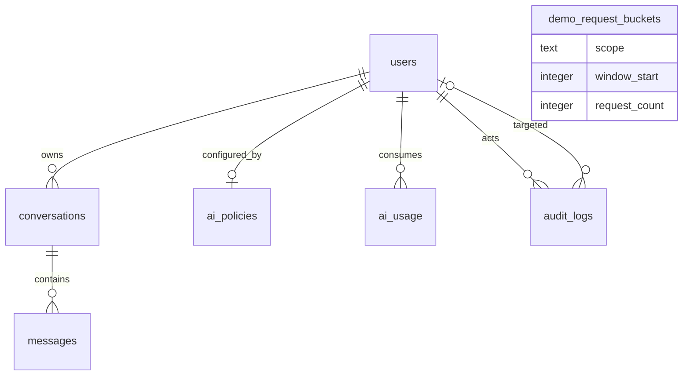

# Database and concurrency

## SQLite and Drizzle

SQLite is an embedded relational database stored in a file; it does not require a separate database server. Drizzle ORM gives TypeScript schema/query/migration tooling over SQLite—it is not itself the database. `db/schema.ts` declares the tables and checks, `db/index.ts` creates the server-only `better-sqlite3` connection with foreign keys enabled, and `drizzle/` contains generated SQL migration history.

Main tables:

| Table | Purpose / constraints |
| --- | --- |
| `users` | unique normalized email, Argon2 hash, role and status check constraints |
| `conversations` | owner FK to user, creation timestamp |
| `messages` | conversation FK, `user`/`assistant` role constraint, content and timestamp; indexed by conversation and ID |
| `ai_policies` | one row per user, bounded prompt and daily request settings |
| `ai_usage` | one row for each admitted private request; indexed by user/time |
| `audit_logs` | required actor, optional target, constrained action, safe metadata JSON text, timestamp and actor/target/time indexes |
| `demo_request_buckets` | composite primary key by hashed/fixed scope and time window, nonnegative counter |

Conversations and messages are separate rows so ownership, message ordering, role constraints, and per-conversation access can be queried and enforced relationally. A single JSON blob would make those relationships, indexes, foreign keys, and updates harder to validate.

## Migrations

Change `db/schema.ts`, generate with `npm run db:generate`, inspect generated SQL/snapshot/journal, and apply locally with `npm run db:migrate`. The container's `scripts/migrate.mjs` applies already-generated migrations before the server starts. Production boot does not generate schema changes. Test migrations against a fresh disposable database before deployment; back up real data before applying schema changes.

## Transactions and race protection

SQLite transactions make a set of database changes commit or roll back together. Drizzle operations use SQLite transactions in `lib/admin-user-transactions.ts` and AI-policy update route. For account provisioning, password hashing occurs before the transaction; within it, each user insert and its successful provisioning audit row are coupled. A status transition and corresponding audit row share an immediate transaction. AI policy write plus audit also share a transaction. No transaction is held open across provider network calls.

`lib/chat-admission.ts` uses `{ behavior: "immediate" }` to serialize status/policy recheck, ownership/history read, quota check, and insertion of the user message plus usage row. Without serial admission, two requests could both observe the last quota slot and exceed a limit. The provider call happens after this transaction, so SQLite is not locked during model generation. Consequence: an accepted user row and quota count remain if inference later fails.

The tests use separate SQLite connections/workers to compete for final quota slots and inject audit failures. SQLite's immediate transaction is an app-level integrity measure; busy locks fail without an automatic retry policy. A single local database on one host is the intended deployment shape. Network filesystems, multiple app replicas, or serverless ephemeral disks need a different data architecture.

## Audit behavior

`lib/audit-write.ts` requires a server-side Drizzle transaction and accepts only the `AuditAction` union. Admin API callers cannot submit an arbitrary audit event. Existing actions cover provisioning, status transitions, and AI policy changes. Metadata is limited by application convention to small safe fields/diffs; the database owner can still modify the SQLite file, so this is not tamper-evident forensic storage.

## Verification

`tests/step11-database.test.mjs` covers independent-connection quota contention, lock failure atomicity, duplicate/concurrent provisioning, audit rollback, status-transition behavior, disabled-account admission, and schema foreign-key/check constraints. `tests/public-demo.test.mjs` checks dedicated demo database gating, ownership, login limits, and isolated setup/reset behavior. These tests do not prove behavior on a particular Ubuntu disk, power-loss recovery, backup restore, or multi-host deployment.
