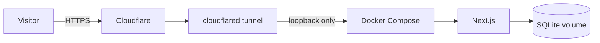

# Future Ubuntu deployment runbook

**Planning only.** The host, tunnel, DNS, HTTPS, and public URL have not been verified. This guide makes no hosting or DNS changes. Do not alter the existing portfolio site.

## Planned topology



The planned hostname is `aegis.ansh0eman.in`; it is not a verified live service.

## Host and secrets

When the host is available, install supported Ubuntu updates and Docker Engine/Compose using current official instructions. Use a dedicated operator account, SSH keys, a restrictive firewall, and host updates. Expose no inbound app port; the app should remain loopback-bound behind the tunnel.

On the host, create `.env.local` with restrictive permissions. Generate a new `AUTH_SECRET`, set `AUTH_COOKIE_SECURE=true` for HTTPS, keep registration closed, and configure only the provider secrets you need. Never reuse development secrets or put credentials in Git, images, build args, shell history, or the public demo.

## Start and verify

```bash
docker compose --env-file .env.local config --quiet
docker compose --env-file .env.local up --build -d
docker compose --env-file .env.local ps
docker compose --env-file .env.local logs --tail=100 aegis
curl --fail http://127.0.0.1:3000/
```

Confirm migrations, closed registration, secure cookies through HTTPS, deliberate admin bootstrap, chat failure handling, persistence after container replacement, and restore from backup. Do not send a real inference request until provider billing limits are reviewed.

## Persistence and operations

The named `/data` volume persists SQLite but is not a backup. Keep encrypted backups elsewhere, test restores into a separate database, and back up before upgrades. Monitor free space, container health/restarts, SQLite lock errors, provider quotas, and backup/restore success. Keep one app instance; this SQLite/process-local design is not for horizontal scaling.

## Tunnel and acceptance

Only after the host and account are ready, configure a Cloudflare Tunnel from `aegis.ansh0eman.in` to `http://127.0.0.1:3000`. Protect its credential, verify TLS and secure-cookie behavior, and confirm the tunnel is the only public path. Check live dashboard/DNS/account settings at setup time; do not change portfolio DNS.

Before considering deployment complete, verify host recovery access, secret handling, registration closure, persistence, migration and restore, provider limits, monitoring, reboot behavior, and an incident/rollback plan. No automatic backup, alerting, or operations dashboard is currently provided.
