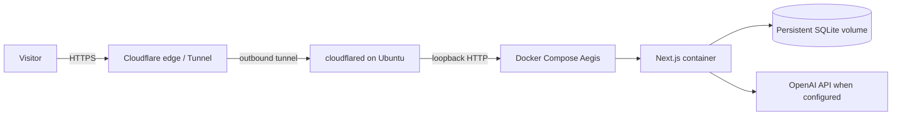

# Future Ubuntu home-server deployment runbook

Status: planning only. The physical MSI laptop/server is not currently available; this runbook has not been executed. It does not change hosting, DNS, the portfolio site, or Cloudflare settings.

## Target topology



The planned public hostname is `aegis.ansh0eman.in`, but domain ownership/configuration, DNS, tunnel, origin rules, and public deployment remain unverified. The portfolio's existing hosting/DNS must remain untouched.

## 1. Prepare Ubuntu

On a supported Ubuntu Server install, apply security updates and install Docker Engine plus the Compose plugin from Docker's official Ubuntu instructions. Confirm `docker version` and `docker compose version`. Create a dedicated non-root operator account, use SSH keys, disable password SSH only after validating key access and recovery, enable a restrictive firewall (SSH from trusted networks; no inbound app port), and keep unattended security updates/regular patching configured.

Do not copy/paste an install script without verifying its source and current official instructions. Package names and vendor installation steps can change; confirm them when the machine exists.

## 2. Prepare app files and secrets

Clone the selected GitHub revision on the server and review it. Create a server-side `.env.local` (permissions `0600`, owned by the operator) from `.env.example`; set a new strong `AUTH_SECRET`, `AUTH_COOKIE_SECURE=true`, and only the provider secrets/settings you intend to use. Do not reuse this development machine's `AUTH_SECRET`, OpenAI key, or database. Keep registration closed. Never put secrets in Compose build arguments, a Dockerfile, repository, issue, shell history, or public demo.

For the standard private service, Compose binds to loopback port 3000 and stores SQLite in its named volume. Verify volume creation, free space, and write permissions. Do not enable a shared public account demo on the private database. If you later want that demo, deploy a separate service/volume with its dedicated path and distinct credentials after reviewing its sharing risks.

## 3. Build and verify locally on the host

```bash
docker compose --env-file .env.local config --quiet
docker compose --env-file .env.local up --build -d
docker compose --env-file .env.local ps
docker compose --env-file .env.local logs --tail=100 aegis
curl --fail http://127.0.0.1:3000/
```

Verify startup migrations, registration behavior, login cookie flags through HTTPS once tunneled, admin bootstrap, chat provider error handling, database persistence after recreating the container, disk usage, and restore from a tested backup. Do not send a real model request in acceptance until you explicitly accept provider billing.

## 4. Persistent data, backups and recovery

Use the named volume for `/data`, but also maintain encrypted backups on a separate storage target. A backup on the same laptop does not protect against theft, disk failure, or ransomware. Define a retention policy, protect encryption keys separately, and perform restore drills into a different volume/database. For upgrades, take and verify a backup first; retain the prior image/revision and a documented rollback plan. A schema migration may not be safely reversible merely by switching images.

Monitor backup success, last successful restore test, free disk, SQLite write/lock errors, container health/restarts, and provider quota/errors. Do not rely solely on Docker's HTTP healthcheck or console logs.

## 5. Cloudflare Tunnel and HTTPS

Only after the server is ready: create a Cloudflare Tunnel in the intended account, install/authenticate `cloudflared` using the current Cloudflare dashboard/docs, and configure the tunnel's public hostname `aegis.ansh0eman.in` to the local origin `http://127.0.0.1:3000`. Verify the exact hostname and certificate behavior in a browser, and confirm Cloudflare Tunnel is the only public path to the app. Do not expose port 3000 at the router or firewall. Set `AUTH_COOKIE_SECURE=true` before accepting logins over HTTPS.

Cloudflare account options, tunnel token handling, DNS state, and Access policies must be verified live at setup time. Store the tunnel credential as a protected runtime secret and use a system service/container restart policy so the tunnel returns after reboot. Do not edit the existing portfolio's records.

## 6. Startup, maintenance, and resources

Use Docker restart policies (the current Compose service uses `unless-stopped`) and ensure Docker starts at boot. If cloudflared runs outside Compose, configure a dedicated systemd service according to its official instructions; verify restart after reboot. Set a safe update cadence, test upgrades before applying them, watch laptop thermals/power, configure sleep/hibernation behavior appropriate for an always-on server, and plan UPS/power-loss recovery if needed.

Review OS and image security updates, admin login attempts, provider quota, backups, disk, and logs on a schedule. Protect physical access and the Docker socket (root-equivalent). This project does not currently provide an operations dashboard, alerting integration, or automatic backup service.

## Acceptance checklist (future)

- [ ] Dedicated Ubuntu host updated and hardened; recovery SSH path tested.
- [ ] Docker/Compose versions documented; app runs as non-root and only on loopback.
- [ ] Fresh production-only secrets generated and protected.
- [ ] HTTPS tunnel verified at intended hostname without portfolio DNS changes.
- [ ] Secure session cookie confirmed; registration stays closed.
- [ ] Persistent volume, migration, backup, and restore verified.
- [ ] Provider-side spending limits and request policy reviewed.
- [ ] Monitoring, restart after reboot, maintenance, and incident response documented.
- [ ] Separate demo environment and explicit disclosure reviewed before any public shared credentials.
